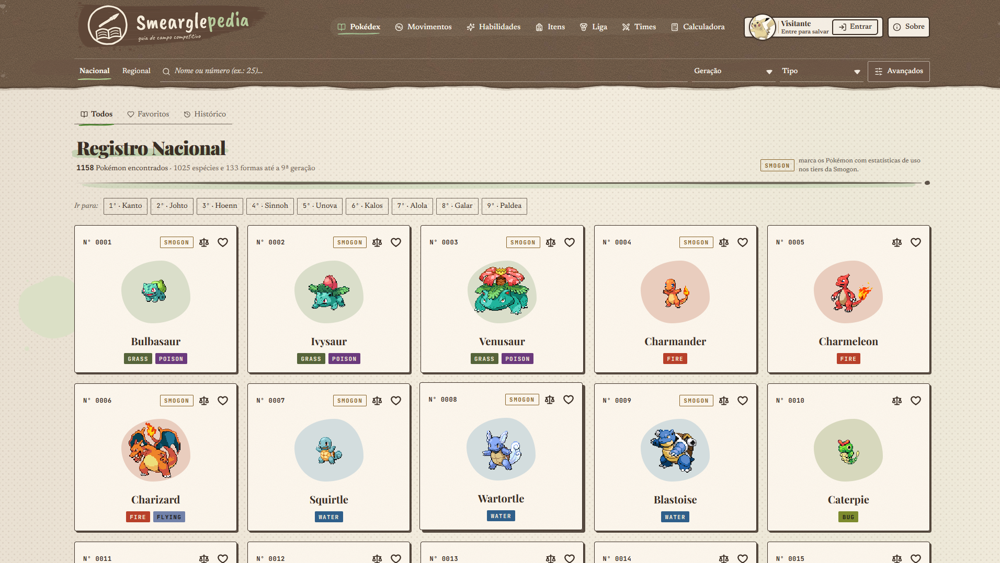

# Smearglepedia

Pokédex com dados competitivos da Smogon, fichas de campo e um team builder.

**Produção:** [smearglepediaa.netlify.app](https://smearglepediaa.netlify.app) · API: [pokemon-team-analytics.onrender.com](https://pokemon-team-analytics.onrender.com/docs)



## Arquitetura

| Camada | Tecnologia | Hospedagem |
|---|---|---|
| Frontend | SPA em React 18 + Vite + Tailwind | Netlify |
| Backend | FastAPI (Python 3.11) | Render |
| Banco de dados e autenticação | Supabase (Postgres + Auth) | Supabase |
| Dados de Pokémon | PokéAPI, consultada direto pelo navegador | — |
| Dados competitivos | Estatísticas mensais da Smogon, importadas para a tabela `smogon_stats` | — |

O frontend busca na PokéAPI os dados de espécies, golpes e habilidades, e no backend as estatísticas da Smogon. O login e os times salvos usam o Supabase direto, com a chave anon. O frontend monta o cliente só com `@supabase/auth-js` e `@supabase/postgrest-js` (`services/supabase.js`), sem o `supabase-js` completo: storage, realtime e functions não são usados e deixavam o pacote inicial cerca de 100 KB maior. O backend valida o JWT do Supabase nas rotas protegidas e é o único que usa a service role.

## Funcionalidades

- **Pokédex:** 1025 espécies e 133 formas regionais e alternativas, com filtros por geração, tipo, habilidade, golpe e grupo de ovos.
  - A grade monta 24 cards por vez e carrega o próximo lote ao rolar.
  - A busca por nome ou número só refiltra quando a digitação pausa (debounce de 250 ms).
- **Ficha de campo:**
  - status base, fraquezas e resistências, árvore evolutiva, locais de encontro e cry;
  - formas alternativas e versão shiny;
  - painel competitivo da Smogon por tier e learnset por geração.
- **Modais de habilidades e golpes:** abrem ao clicar na ficha, no painel Smogon ou nas tabelas de movimentos e habilidades.
  - Mostram tipo, categoria, poder, precisão, PP, alvo e o efeito em batalha.
  - Os textos vêm da PokéAPI em pt-BR quando existem e caem para o inglês, com aviso, quando não há tradução. Hoje a PokéAPI tem pouca tradução em português.
- **Team Builder:** time de até 6 Pokémon.
  - Sugere candidatos por cobertura de tipos e sinergia no meta da Smogon.
  - Sugestões: o melhor próximo Pokémon para a vaga seguinte, pelo time atual e pelo meta do OU.
  - Esboço: monta times inteiros para um plano (tier de singles, estilo como Balance, Chuva ou Trick Room, Pokémon proibidos e limite de tipos repetidos). Cada time cobre as funções do estilo (Hazards, Hazard Control, Pivot…), vem com sets completos (item, habilidade, Tera, EVs e golpes das builds da Smogon) e leva uma nota do teste do meta: cada membro duela com as 20 ameaças mais usadas do tier (com Stealth Rock na entrada, prioridade, a versão boostada pelo setup e a com Tera), a nota premia ter mais de uma resposta sólida e desconta quem carrega o time sozinho ou é 4x fraco a Rock sem Boots. O card explica as duas notas e mostra quem responde a cada ameaça.
  - Esboço editável: cada card aceita fixar membros, trocar um membro vendo antes o efeito de cada opção nas notas (teste do meta, encaixe e ameaças resolvidas ou pioradas), corrigir a pior ameaça com uma troca que não baixa o teste do meta, regenerar o resto mantendo os fixos e desfazer qualquer edição.
  - Habilidade e Tera no set de cada Pokémon, usados também pela calculadora de dano.
  - Exportação do time para o Pokémon Showdown.
  - Mostra a tabela de fraquezas e cobertura do time.
  - Times salvos na conta do usuário.
- **Liga:** líderes de ginásio, Elite 4, campeões, rivais, equipes vilãs e as facções de Hisui, de Kanto a Kitakami, lidos da tabela `PokemonTrainers`.
  - Cada card junta as batalhas do treinador; a ficha mostra o time de cada batalha e abre o confronto na calculadora de dano.
  - Os cards seguem a ordem do jogo dentro de cada região: líderes, Elite 4, campeão, rivais e depois as equipes vilãs, com o chefe antes dos subordinados. O mapa de papéis fica em `frontend/src/utils/trainers.js`; um papel que não estiver nele vai para o fim da lista.
- **Links diretos:** a ficha de um Pokémon e a de um treinador têm endereço próprio, que pode ser compartilhado.
  - `#/pokedex?pokemon=garchomp` abre a ficha do Garchomp; o parâmetro funciona em qualquer aba.
  - `#/treinadores/giovanni` abre o Giovanni na Liga.
  - Aberta por clique, a ficha ganha uma entrada no histórico e o botão voltar a fecha. Trocar de Pokémon dentro dela (evolução, forma) não cria entradas novas.
- **Prévia do link:** `frontend/public/og.png` (1200×630) e as tags Open Graph do `index.html` dão imagem e descrição ao link no WhatsApp, Discord e redes sociais.
- **Mobile:** em telas pequenas, blur, sombras longas, a inclinação 3D dos cards e o embed do mascote ficam desligados.

## Rodando localmente

Pré-requisitos: Docker (ou Python 3.11), Node 22 e um projeto Supabase.

```bash
# Backend em http://localhost:8000 (documentação em /docs)
cp backend/.env.example backend/.env    # preencha as chaves do Supabase
docker compose up --build

# Frontend em http://localhost:5173, em outro terminal
cd frontend
cp .env.example .env
npm install
npm run dev
```

O `docker-compose.yml` sobe só o backend. Em desenvolvimento `VITE_API_URL` fica vazio e o Vite redireciona `/api` para `http://localhost:8000`.

Sem Docker, o backend roda a partir de `backend/` com `pip install -r requirements.txt` e `uvicorn app.main:app --reload --port 8000`.

## Variáveis de ambiente

Backend (`backend/.env`, ou Environment no Render):

| Variável | Obrigatória | Notas |
|---|---|---|
| `SUPABASE_URL` | sim | |
| `SUPABASE_SERVICE_ROLE_KEY` | sim | só no servidor |
| `SUPABASE_JWT_SECRET` | sim | valida os tokens enviados pelo frontend |
| `ALLOWED_ORIGINS` | não | origens CORS separadas por vírgula; por padrão `http://localhost:5173` |
| `DEFAULT_TIER` | não | por padrão `gen9ou` |
| `SMOGON_BADGE_TIERS` | não | tiers considerados para o selo "Smogon" na grade |

Frontend (`frontend/.env`, ou Environment variables no Netlify):

| Variável | Notas |
|---|---|
| `VITE_API_URL` | URL do serviço no Render; vazio em desenvolvimento |
| `VITE_SUPABASE_URL` | |
| `VITE_SUPABASE_ANON_KEY` | chave anon, nunca a service role |

As `VITE_*` são embutidas no bundle durante o build. Depois de alterá-las no Netlify, é preciso fazer um novo deploy.

## Deploy

**Frontend (Netlify).** O `netlify.toml` na raiz define `base = "frontend"`, o build, a pasta `dist`, os headers de cache e o fallback de SPA. Basta conectar o repositório e definir as três `VITE_*`.

**Backend (Render).** Web Service com Root Directory `backend`:

- Build: `pip install -r requirements.txt`
- Start: `uvicorn app.main:app --host 0.0.0.0 --port $PORT`
- Health check: `/health`

`ALLOWED_ORIGINS` precisa incluir `https://smearglepediaa.netlify.app`, sem barra no final.

No plano gratuito o Render suspende o serviço após 15 minutos sem tráfego, e a primeira requisição seguinte demora para responder. Por isso as leituras da Smogon (selo da grade, ficha, meta do team builder) vão direto ao Supabase, liberadas pela política `smogon_stats_public_read` (os treinadores, pela `pokemon_trainers_public_read`); o backend fica com a recomendação e a sincronização. O Supabase gratuito também pausa projetos inativos.

### CI

`ci.yml` roda em push na `main` e na `futuras-atualizacoes` e em todo pull request:

- frontend: `npm run lint`, `npm test` e `npm run build`;
- backend: `ruff check .` e `pytest` (Supabase falso em memória, sem rede).

O `npm test` inclui `trainers-data.test.js`, que lê a tabela `PokemonTrainers` e falha se aparecer uma região, papel, etapa, mecânica ou jogo que o frontend não conhece. Ele lê com a chave anon, como o site, e usa os secrets `SUPABASE_URL` e `SUPABASE_ANON_KEY` (a mesma `VITE_SUPABASE_ANON_KEY` do Netlify). A `SUPABASE_KEY` do keep-alive é a service role, que não tem permissão na `PokemonTrainers`. Sem os secrets, o teste é pulado (pull requests de forks, por exemplo). Para rodar localmente:

```bash
cd frontend
SUPABASE_URL=... SUPABASE_ANON_KEY=... npx vitest run src/utils/trainers-data.test.js
```

Com tudo verde em um push na `main`, o job `deploy-backend` chama o deploy hook do Render. Para usar, desligue o auto-deploy do serviço no Render e salve a URL do hook no secret `RENDER_DEPLOY_HOOK_URL`; sem o secret, o job não faz nada.

```bash
cd backend
pip install -r requirements.txt -r requirements-dev.txt
ruff check . && pytest
```

### Tarefas agendadas (GitHub Actions)

| Workflow | Quando (UTC) | O que faz | Secrets |
|---|---|---|---|
| `keep-alive.yml` | a cada 10 minutos | `GET /health` no Render, para o serviço não dormir | nenhum |
| `smogon-sync.yml` | dia 2, 06:00 | `POST /api/admin/sync-smogon` e espera até todos os tiers estarem no mês anterior | `SUPABASE_JWT_SECRET` |
| `supabase-keepalive.yml` | de 3 em 3 dias, 09:00 | consulta a tabela `smogon_stats` no Supabase | `SUPABASE_URL`, `SUPABASE_KEY` |
| `trainer-data-check.yml` | segunda, 12:00 | o mesmo teste de dados da `PokemonTrainers`, porque a tabela muda direto no Supabase, sem push | `SUPABASE_URL`, `SUPABASE_ANON_KEY` |
| `keep-active.yml` | dia 1, 05:00 | commit vazio na `main`, para o GitHub não desativar os agendamentos | nenhum |

Os secrets ficam em Settings > Secrets and variables > Actions. Todos os workflows também podem ser disparados manualmente na aba Actions.

O GitHub desativa workflows agendados após 60 dias sem atividade no repositório; o `keep-active.yml` evita isso com um commit vazio por mês, marcado com `[skip ci]` para não disparar deploy no Netlify.

## Dados da Smogon

`backend/app/scrapers/update_smogon.py` baixa os arquivos de uso e de moveset de `smogon.com/stats/<mês>/` para os tiers da Geração 9 (OU, Ubers, UU, RU, NU, PU, LC, Doubles OU) e faz upsert na tabela `smogon_stats`, com chave única `(name, tier, date)`.

```bash
cd backend
python -m app.scrapers.update_smogon            # mês anterior ao atual
python -m app.scrapers.update_smogon 2026-10    # mês específico
```

A API usa sempre o mês mais recente que existir na tabela. A recomendação monta as matrizes de afinidade uma vez por tier e mês e as mantém em memória até chegar um mês novo.

As migrations ficam em `supabase/migrations/`. A `name_key` (nome em minúsculas, coluna gerada) e o índice `(tier, name_key, date)` atendem a busca de um Pokémon por nome.

## API

| Método | Caminho | Auth | |
|---|---|---|---|
| GET | `/health` | não | |
| GET | `/api/smogon/names` | não | Pokémon com dados na Smogon, por tier |
| GET | `/api/pokemon/{name}/stats` | não | estatísticas de um Pokémon (`?tier=`, `?date=`) |
| POST | `/api/recommend` | sim | recomendação para o time |
| POST | `/api/admin/sync-smogon` | sim | sincronização com a Smogon |

As rotas autenticadas esperam `Authorization: Bearer <access token do Supabase>`.

## Estrutura

```
backend/
  app/
    main.py          rotas /health, /api/recommend, /api/admin/sync-smogon
    core/            configuração e validação do JWT
    routers/         estatísticas da Smogon
    scrapers/        importação da Smogon
    services/        recomendação, PokéAPI e consultas à smogon_stats
  tests/             pytest com Supabase falso em memória
    schemas/         modelos Pydantic
frontend/
  src/
    sections/        uma tela por aba: Pokédex, Movimentos, Habilidades, Itens, Treinadores, Team Builder, Damage Calculator
    components/      grade, ficha, modais; layout/ (header, abas, filtros contextuais), team/, calc/, items/, trainers/
    navigation/      lista das abas e endereços por hash (#/pokedex, #/treinadores/giovanni, ?pokemon=…)
    data/            jogos e dexes regionais, TMs por jogo, índice da Pokédex
    hooks/           filtros da Pokédex, dex regional, dados de batalha, pontuação do team builder
    services/        PokéAPI (com cache no IndexedDB), backend e Supabase
    utils/           filtros, tabela de tipos, atributos (EVs/IVs/natureza), cálculo de dano
scripts/
  build-machines.mjs       gera frontend/src/data/machines.json a partir dos CSVs da PokéAPI
  build-pokedex-index.mjs  gera frontend/src/data/pokedex-index.json (variedades, espécies, tipos, grupos de ovos)
  build-battle-data.mjs    gera frontend/src/data/battle-data.json (atributos base e golpes, para o esboço)
  build-abilities.mjs      gera frontend/src/data/abilities.json (habilidades, efeito curto e quem tem cada uma)
  build-items.mjs          gera frontend/src/data/items.json (itens com categoria e bolso, para a aba Itens)
supabase/migrations/ políticas e índices das tabelas smogon_stats e PokemonTrainers
.github/workflows/   CI, keep-alives, sincronização mensal e commit de atividade
netlify.toml         build e headers do frontend
docker-compose.yml   backend local
```
