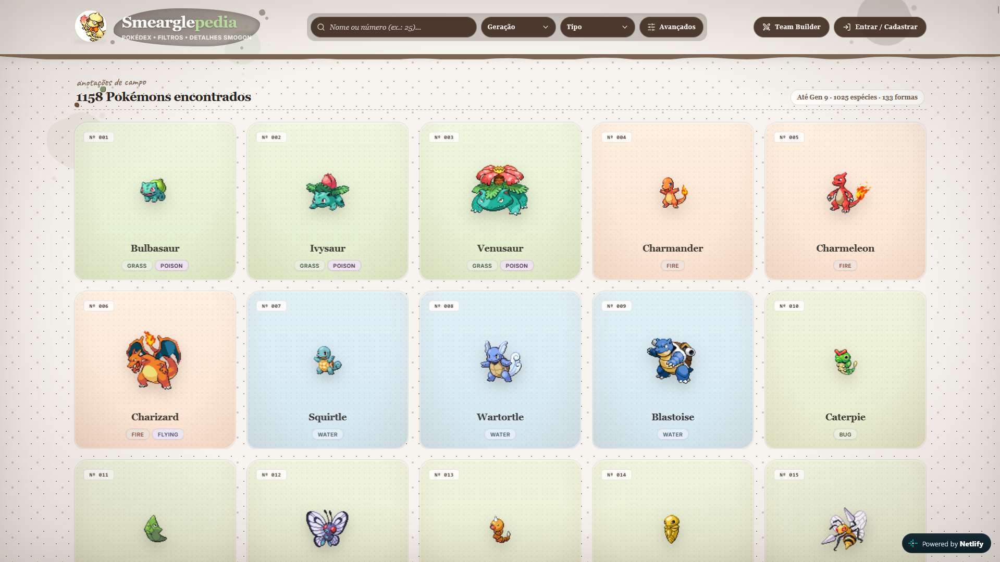

# Smearglepedia

Pokédex com dados competitivos da Smogon, fichas de campo e um team builder.

**Produção:** [smearglepedia.netlify.app](https://smearglepedia.netlify.app) · API: [pokemon-team-analytics.onrender.com](https://pokemon-team-analytics.onrender.com/docs)



## Arquitetura

| Camada | Tecnologia | Hospedagem |
|---|---|---|
| Frontend | SPA em React 18 + Vite + Tailwind | Netlify |
| Backend | FastAPI (Python 3.11) | Render |
| Banco de dados e autenticação | Supabase (Postgres + Auth) | Supabase |
| Dados de Pokémon | PokéAPI, consultada direto pelo navegador | — |
| Dados competitivos | Estatísticas mensais da Smogon, importadas para a tabela `smogon_stats` | — |

O frontend busca na PokéAPI os dados de espécies, golpes e habilidades, e no backend as estatísticas da Smogon. O login e os times salvos usam o Supabase direto, com a chave anon. O backend valida o JWT do Supabase nas rotas protegidas e é o único que usa a service role.

## Funcionalidades

- **Pokédex:** 1025 espécies e 133 formas regionais e alternativas, com filtros por geração, tipo, habilidade, golpe e grupo de ovos.
  - A grade monta 24 cards por vez e carrega o próximo lote ao rolar.
  - A busca por nome ou número só refiltra quando a digitação pausa (debounce de 250 ms).
- **Ficha de campo:**
  - status base, fraquezas e resistências, árvore evolutiva, locais de encontro e cry;
  - formas alternativas e versão shiny;
  - painel competitivo da Smogon por tier e learnset por geração.
- **Modais de habilidades e golpes:** abrem ao clicar na ficha, no painel Smogon ou na tabela de movimentos.
  - Mostram tipo, categoria, poder, precisão, PP, alvo e o efeito em batalha.
  - Os textos vêm da PokéAPI em pt-BR quando existem e caem para o inglês, com aviso, quando não há tradução. Hoje a PokéAPI tem pouca tradução em português.
- **Team Builder:** time de até 6 Pokémon.
  - Sugere candidatos por cobertura de tipos e sinergia no meta da Smogon.
  - Mostra a tabela de fraquezas e cobertura do time.
  - Times salvos na conta do usuário.
- **Mobile:** em telas pequenas, blur, sombras longas, a inclinação 3D dos cards e o embed do mascote ficam desligados.

## Rodando localmente

Pré-requisitos: Docker (ou Python 3.11), Node 22 e um projeto Supabase.

```bash
# Backend em http://localhost:8000 (documentação em /docs)
cp backend/.env.example backend/.env    # preencha as chaves do Supabase
docker compose up --build

# Frontend em http://localhost:5173, em outro terminal
cd frontend
cp .env.example .env
npm install
npm run dev
```

O `docker-compose.yml` sobe só o backend. Em desenvolvimento `VITE_API_URL` fica vazio e o Vite redireciona `/api` para `http://localhost:8000`.

Sem Docker, o backend roda a partir de `backend/` com `pip install -r requirements.txt` e `uvicorn app.main:app --reload --port 8000`.

## Variáveis de ambiente

Backend (`backend/.env`, ou Environment no Render):

| Variável | Obrigatória | Notas |
|---|---|---|
| `SUPABASE_URL` | sim | |
| `SUPABASE_SERVICE_ROLE_KEY` | sim | só no servidor |
| `SUPABASE_JWT_SECRET` | sim | valida os tokens enviados pelo frontend |
| `ALLOWED_ORIGINS` | não | origens CORS separadas por vírgula; por padrão `http://localhost:5173` |
| `DEFAULT_TIER` | não | por padrão `gen9ou` |
| `SMOGON_BADGE_TIERS` | não | tiers considerados para o selo "Smogon" na grade |

Frontend (`frontend/.env`, ou Environment variables no Netlify):

| Variável | Notas |
|---|---|
| `VITE_API_URL` | URL do serviço no Render; vazio em desenvolvimento |
| `VITE_SUPABASE_URL` | |
| `VITE_SUPABASE_ANON_KEY` | chave anon, nunca a service role |

As `VITE_*` são embutidas no bundle durante o build. Depois de alterá-las no Netlify, é preciso fazer um novo deploy.

## Deploy

**Frontend (Netlify).** O `netlify.toml` na raiz define `base = "frontend"`, o build, a pasta `dist`, os headers de cache e o fallback de SPA. Basta conectar o repositório e definir as três `VITE_*`.

**Backend (Render).** Web Service com Root Directory `backend`:

- Build: `pip install -r requirements.txt`
- Start: `uvicorn app.main:app --host 0.0.0.0 --port $PORT`
- Health check: `/health`

`ALLOWED_ORIGINS` precisa incluir `https://smearglepedia.netlify.app`, sem barra no final.

No plano gratuito o Render suspende o serviço após 15 minutos sem tráfego, e a primeira requisição seguinte demora para responder. O Supabase gratuito também pausa projetos inativos.

### Tarefas agendadas (GitHub Actions)

| Workflow | Quando (UTC) | O que faz | Secrets |
|---|---|---|---|
| `keep-alive.yml` | a cada 10 minutos | `GET /health` no Render, para o serviço não dormir | nenhum |
| `smogon-sync.yml` | dia 2, 06:00 | `POST /api/admin/sync-smogon` e espera até todos os tiers estarem no mês anterior | `SUPABASE_JWT_SECRET` |
| `supabase-keepalive.yml` | de 3 em 3 dias, 09:00 | consulta a tabela `smogon_stats` no Supabase | `SUPABASE_URL`, `SUPABASE_KEY` |
| `keep-active.yml` | dia 1, 05:00 | commit vazio na `main`, para o GitHub não desativar os agendamentos | nenhum |

Os secrets ficam em Settings > Secrets and variables > Actions. Todos os workflows também podem ser disparados manualmente na aba Actions.

O GitHub desativa workflows agendados após 60 dias sem atividade no repositório; o `keep-active.yml` evita isso com um commit vazio por mês, marcado com `[skip ci]` para não disparar deploy no Netlify.

## Dados da Smogon

`backend/app/scrapers/update_smogon.py` baixa os arquivos de uso e de moveset de `smogon.com/stats/<mês>/` para os tiers da Geração 9 (OU, Ubers, UU, RU, NU, PU, LC, Doubles OU) e faz upsert na tabela `smogon_stats`, com chave única `(name, tier, date)`.

```bash
cd backend
python -m app.scrapers.update_smogon            # mês anterior ao atual
python -m app.scrapers.update_smogon 2026-10    # mês específico
```

A API usa sempre o mês mais recente que existir na tabela.

## API

| Método | Caminho | Auth | |
|---|---|---|---|
| GET | `/health` | não | |
| GET | `/api/smogon/names` | não | Pokémon com dados na Smogon, por tier |
| GET | `/api/pokemon/{name}/stats` | não | estatísticas de um Pokémon (`?tier=`, `?date=`) |
| POST | `/api/recommend` | sim | recomendação para o time |
| POST | `/api/admin/sync-smogon` | sim | sincronização com a Smogon |

As rotas autenticadas esperam `Authorization: Bearer <access token do Supabase>`.

## Estrutura

```
backend/
  app/
    main.py          rotas /health, /api/recommend, /api/admin/sync-smogon
    core/            configuração e validação do JWT
    routers/         estatísticas da Smogon
    scrapers/        importação da Smogon
    services/        recomendação e PokéAPI
    schemas/         modelos Pydantic
frontend/
  src/
    sections/        uma tela por aba: Pokédex, Itens, Gym Leaders, Team Builder, Damage Calculator
    components/      grade, ficha, modais; layout/ (header, abas, filtros contextuais), team/, calc/, items/, leaders/
    navigation/      lista das abas e rotas por hash (#/pokedex, #/itens…)
    data/            jogos e dexes regionais, líderes de ginásio, TMs por jogo
    hooks/           filtros da Pokédex, dex regional, dados de batalha, pontuação do team builder
    services/        PokéAPI, backend e Supabase
    utils/           filtros, tabela de tipos, atributos (EVs/IVs/natureza), cálculo de dano
scripts/
  build-machines.mjs gera frontend/src/data/machines.json a partir dos CSVs da PokéAPI
.github/workflows/   keep-alives, sincronização mensal e commit de atividade
netlify.toml         build e headers do frontend
docker-compose.yml   backend local
```
